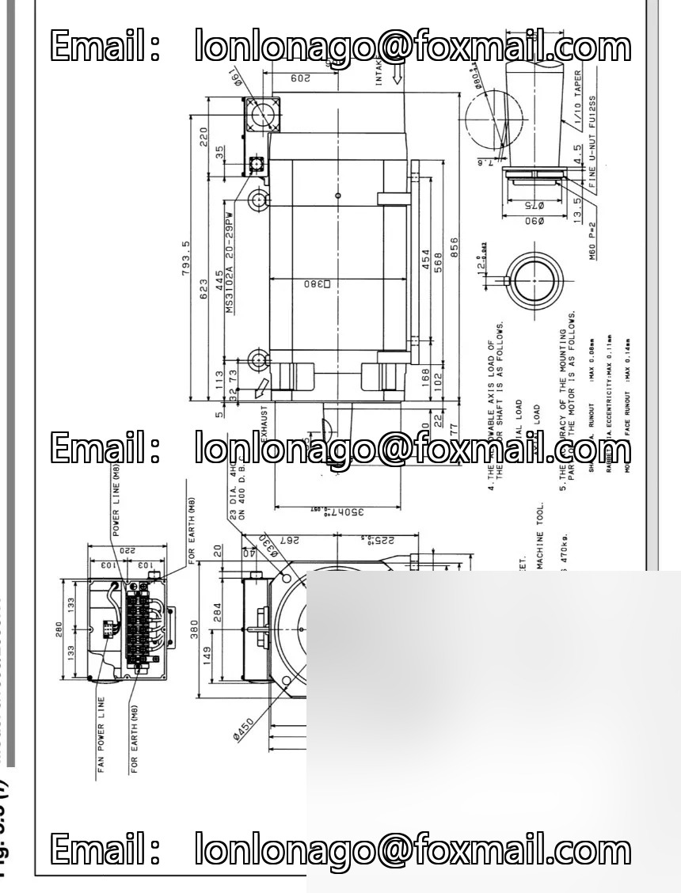
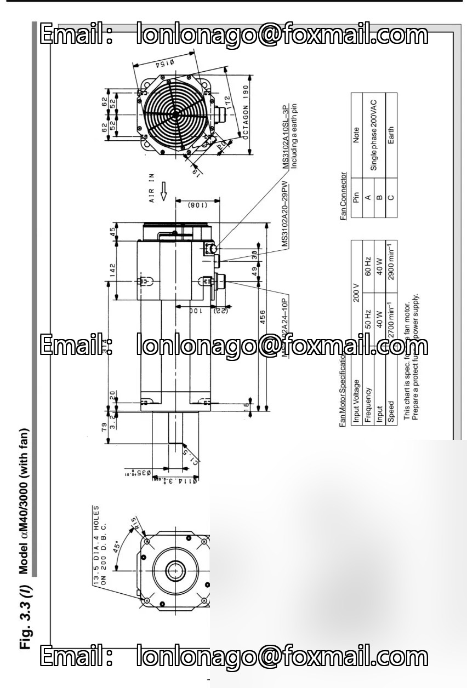
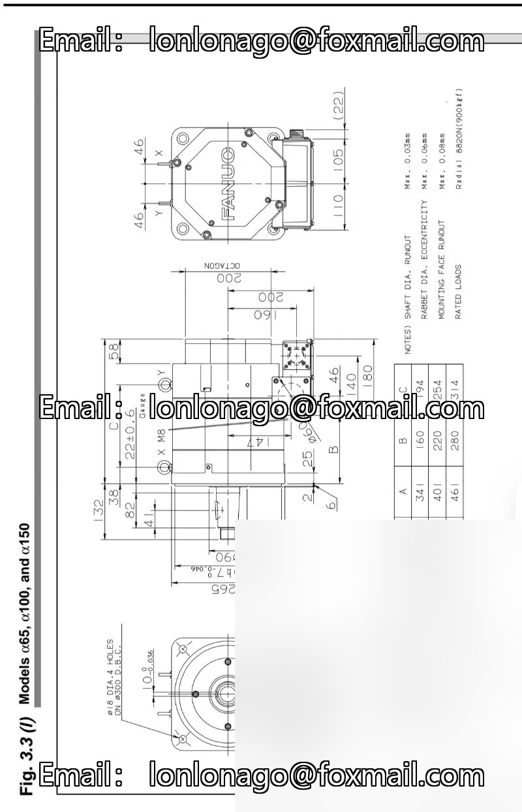
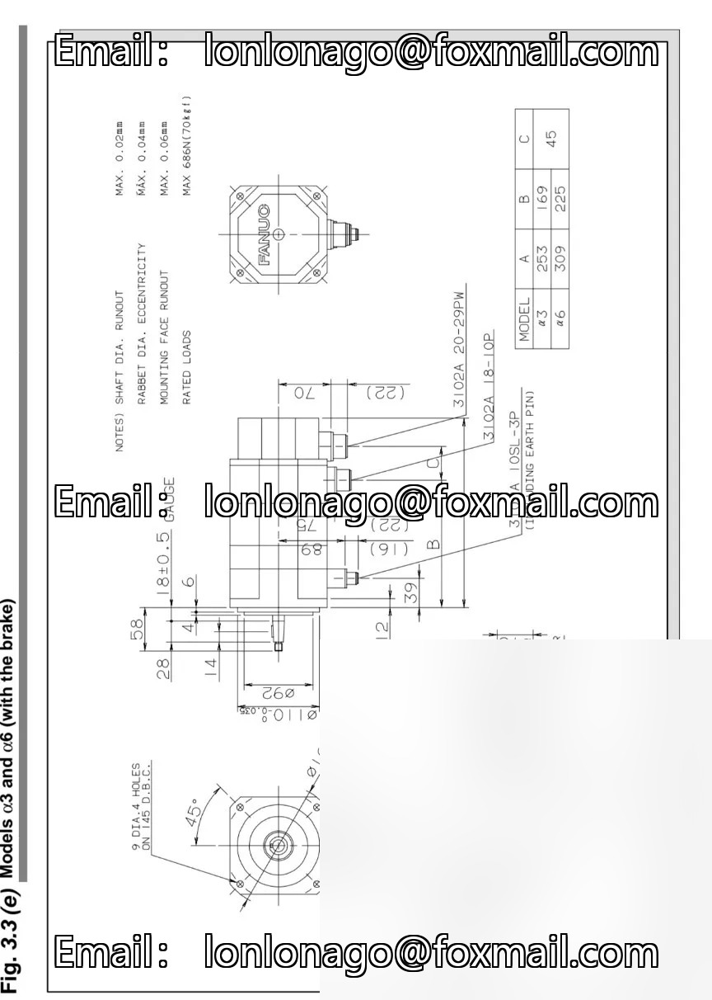
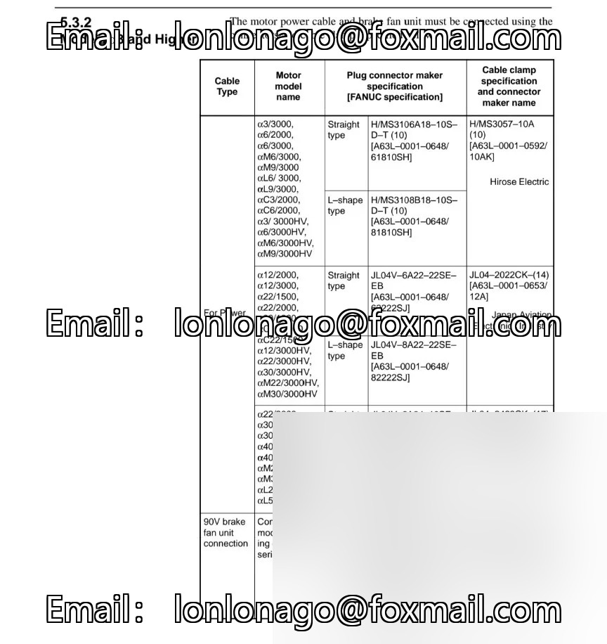

# The technical document PDF of the Fanuc α series AC servo motor, 300 pages.

## Body

FANUC α series AC servo motor technical documents PDF , 300 pages, covering detailed parameters, wiring methods, installation dimensions, etc. of α series servo motors, suitable for use in machining centers, lathes, and other machines.
199-651
non-refundable upon sale. Contact directly for immediate pickup, and communicate issues privately.

This is a FANUC α series AC servo motor technical document PDF, 300 pages, covering motor parameters, wiring methods, installation dimensions, etc., suitable for CNC machines and lathes.

<!-- AI_ENRICHED -->

## Images

## Payment

Here is a pay link on Stripe ( https://buy.stripe.com/3cs8yP7sY87d0vu9AB ). Please contact me lonlonago@foxmail.com after funding $89, and I will send you a complete data files , thank you!

